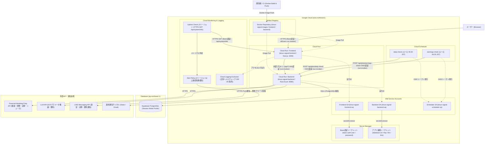
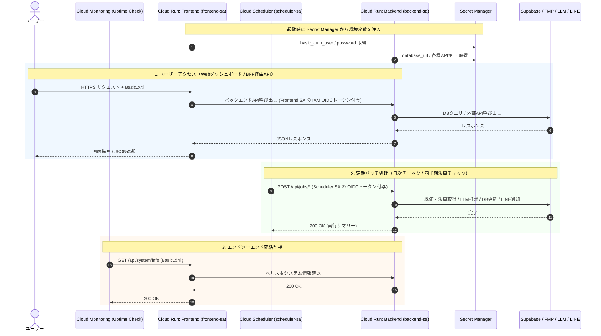

# システム構成図 (`terraform-gcp`)

`terraform-gcp/` の Terraform 定義から読み取れる Google Cloud および外部連携サービスのシステム構成図です。

## 全体アーキテクチャ図

---

## 認証・通信フロー詳細（IAM & セキュリティ境界）

---

## コンポーネント一覧（Terraformファイル対応表）

| カテゴリ | リソース / コンポーネント | 定義ファイル | 役割 |
| :--- | :--- | :--- | :--- |
| **Compute** | `kinun-signal-frontend` (Cloud Run) | `cloud_run.tf` | Next.js ダッシュボードおよびバックエンドへのプロキシ（BFF）。外部公開（Basic認証保護）。 |
| **Compute** | `kinun-signal-backend` (Cloud Run) | `cloud_run.tf` | Rust (Axum / SQLx) APIサーバー・DCF計算エンジン。IAM認証された内部呼び出しのみ許可。 |
| **Batch** | `kinun-signal-daily-check` (Cloud Scheduler) | `scheduler.tf` | 火〜土 06:30 JST に `/api/jobs/daily-check` を OIDC 認証で起動。 |
| **Batch** | `kinun-signal-earnings-check` (Cloud Scheduler) | `scheduler.tf` | 火〜土 06:35 JST に `/api/jobs/earnings-check` を OIDC 認証で起動。 |
| **IAM** | `frontend-sa` / `backend-sa` / `scheduler-sa` | `iam.tf` | 各コンポーネント専用のサービスアカウント。最小権限（`run.invoker`, `secretmanager.secretAccessor`）を付与。 |
| **Security** | `app_secrets` (Secret Manager) | `secrets.tf` | DB接続文字列、外部APIキー（FMP / LLM / LINE）、Basic認証情報を安全に管理。 |
| **Registry** | `kinun-signal-images` (Artifact Registry) | `artifact_registry.tf` | Frontend / Backend の Docker コンテナイメージを格納。 |
| **Monitoring** | Uptime Check / Alert Policy / Logging Exclusion | `monitoring.tf` | 3リージョンからの HTTPS 死活監視、連続失敗時の Slack / Email 通知、正常ヘルスチェックログの除外。 |
