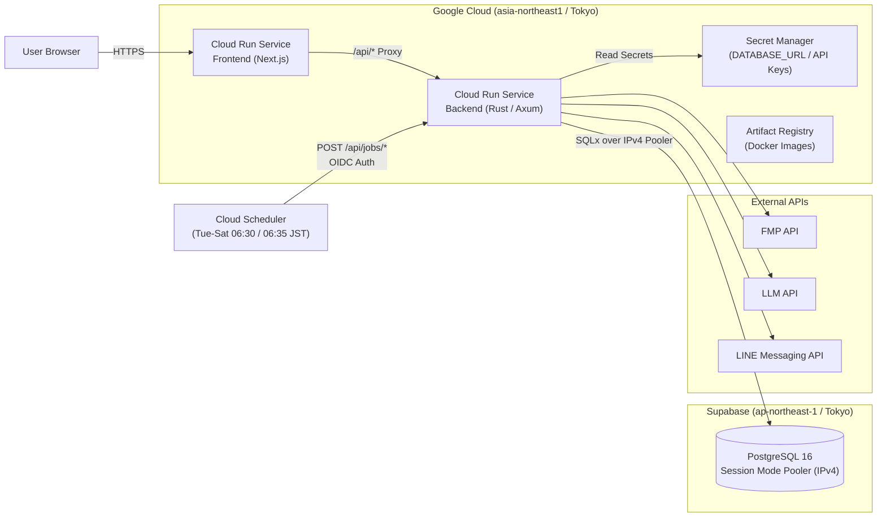

# Personal Stock Analyst (`kinun-signal`) - Google Cloud + Supabase IaC (Terraform)

Google Cloud（Cloud Run / Cloud Scheduler / Secret Manager / Artifact Registry）と **Supabase（Serverless PostgreSQL 東京リージョン）** を組み合わせて、ほぼ無料枠（Scale to Zero）で `kinun-signal` をフルサーバーレス運用するための Terraform 構成です。

---

## アーキテクチャ構成図



---

## 特徴と設計ポイント

1. **完全サーバーレス＆Scale to Zero（維持費ほぼ0円）**
   - Frontend / Backend ともに Cloud Run の `min_instance_count = 0`、`cpu_idle = true`（リクエスト処理中のみ課金）に設定しています。
   - データベースは固定費のかかる Cloud SQL ではなく、**Supabase 無料枠（東京 `ap-northeast-1`・Session Mode Pooler IPv4接続）** を使用します。
2. **バッチ処理は「パターンA（Cloud Scheduler → Cloud Run HTTP エンドポイント）」**
   - バックエンド内の常駐スケジューラは環境変数 `ENABLE_INTERNAL_SCHEDULER=false` で自動停止し、**Cloud Scheduler** から OIDC トークン認証付きで以下のエンドポイントを定期実行します：
     - `POST /api/jobs/daily-check`（火〜土 06:30 JST：米国市場引け後の終値取得・割安アラート・日本語3行ニュース要約）
     - `POST /api/jobs/earnings-check?force=false`（火〜土 06:35 JST：四半期決算チェック＆DCF理論株価の自動再計算）
3. **機密情報の Secret Manager 管理**
   - Supabase の `DATABASE_URL` や各種 API キーは Cloud Run の平文環境変数ではなく、**Google Cloud Secret Manager** に格納し、最小権限の専用サービスアカウント経由で注入します。
4. **Frontend → Backend の動的ルーティング対応**
   - Next.js 側にサーバーサイド Route Handler (`/api/[...path]`) を備えているため、Docker イメージのビルド時に Cloud Run Backend の URL が未確定でも、Terraform が起動時に注入する `BACKEND_INTERNAL_URL` を使って自動的に Backend へ通信します。
5. **Cloud Monitoring による無料死活監視（Uptime Check）＆ Slack通知・ログ除外フィルタ (`monitoring.tf`)**
   - **Uptime Check**: 5分間隔（`300s`）・世界3リージョン（Asia Pacific / USA / Europe）から Basic 認証付きで `/api/system/info`（または `/healthz`）へ HTTPS 死活監視を行います（DBクエリを伴わない軽量チェック）。
   - **Slack アラート通知 (`google_monitoring_notification_channel.slack`)**: 2つ以上のリージョンから5分間連続してチェックが失敗した場合に Slack チャンネルへ即時通知します（Bot トークン `xoxb-...` による完全 IaC 自動構築、または GCP コンソールのワンクリック Slack OAuth 連携のどちらにも対応）。
   - **Cloud Logging 除外フィルタ**: Uptime Check および `/healthz` の正常応答（`HTTP 200`）のアクセスログを Cloud Logging の `_Default` シンクから自動除外し、ログ容量の消費（課金リスク）をゼロに抑えます（異常時の `4xx`/`5xx` ログは通常通り記録されます）。

---

## デプロイ手順（MacBook Air / Apple Silicon 対応）

### 前提条件
- `gcloud` CLI がインストールされ、`gcloud auth login` 済みであること
- Google Cloud プロジェクトに請求先アカウントがリンクされていること
- Docker Desktop が起動していること
- `terraform` (>= 1.9.0) がインストールされていること

### Step 1. 変数ファイル (`terraform.tfvars`) の作成

```bash
cd terraform-gcp
cp terraform.tfvars.example terraform.tfvars
```

`terraform.tfvars` を開き、`project_id`（Google Cloud プロジェクトID）と `.env` で動作確認済みの Supabase `database_url` を設定します。

### Step 2. Terraform 初期化 ＆ Artifact Registry の先行作成

初回デプロイ時は、コンテナイメージを Push する先の Artifact Registry リポジトリを先に作成します。

```bash
terraform init
terraform apply -target=google_artifact_registry_repository.repo
```

### Step 3. Docker イメージのビルド＆Push（Apple Silicon `linux/amd64` 指定）

Cloud Run は `linux/amd64` アーキテクチャで動作するため、MacBook Air (M1/M2/M3/M4) からは `--platform linux/amd64` を指定してビルド＆Pushします。

```bash
# GCPプロジェクトIDを変数にセット
export PROJECT_ID=$(terraform output -raw artifact_registry_url | cut -d'/' -f2)
export REPO_URL=$(terraform output -raw artifact_registry_url)

# Docker認証設定
gcloud auth configure-docker asia-northeast1-docker.pkg.dev

# 1. Backend (Rust) のビルド & Push
docker buildx build --platform linux/amd64 \
  -t "${REPO_URL}/backend:latest" \
  --push ../backend

# 2. Frontend (Next.js) のビルド & Push
docker buildx build --platform linux/amd64 \
  -t "${REPO_URL}/frontend:latest" \
  --push ../frontend
```

### Step 4. 全リソース（Cloud Run FE/BE・Secret Manager・Cloud Scheduler）のデプロイ

イメージの Push が完了したら、残りのすべてのリソースを一括作成します。

```bash
terraform apply
```

完了すると、ターミナルに以下の Output が表示されます：
- `frontend_url`: ブラウザからアクセスするダッシュボード URL
- `backend_url`: Rust API サーバーの URL
- `daily_check_scheduler_job`: 日次バッチジョブ名
- `earnings_check_scheduler_job`: 決算チェックジョブ名

### Step 5. Cloud Scheduler の手動テスト実行（任意）

コンソールまたは以下のコマンドで、Cloud Scheduler から Cloud Run Backend が正常に呼び出せるか即座にテストできます。

```bash
gcloud scheduler jobs run kinun-signal-daily-check --location=asia-northeast1
```
