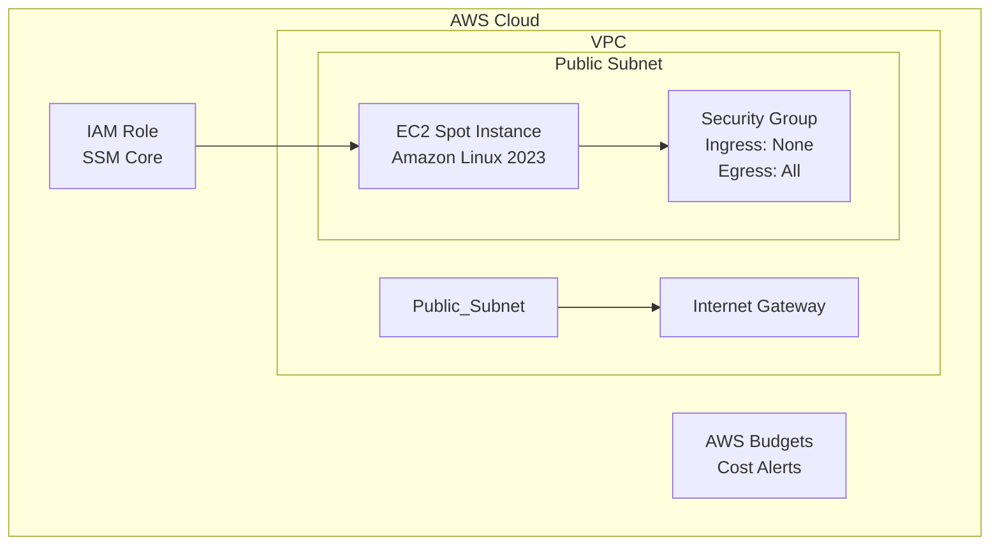

# Spot Verify Environment

This Terraform configuration sets up an ephemeral, low-cost, and secure AWS environment designed for quick container verification. It launches a Spot Instance in a public subnet, configured with zero ingress rules and secured via SSM Session Manager.

## Architecture



## Features
*   **Cost-Effective**: Uses Spot Instances and creates no expensive fixed-cost resources (like NAT Gateways or ALBs).
*   **Zero-Trust Security**: Security Group has NO inbound rules. Access is strictly via AWS Systems Manager (SSM).
*   **Ready-to-Use**: Automatically installs and starts Docker on launch.
*   **Guardrails**: Includes optional AWS Budgets to alert on unexpected costs.

## Requirements
*   Terraform >= 1.9.0
*   AWS CLI configured with appropriate permissions.
*   AWS Session Manager Plugin installed locally for terminal access.

## Usage

1.  **Initialize Terraform**
    ```bash
    terraform init
    ```

2.  **Configure Variables**
    Copy the example vars file and update values (e.g., your email for budget alerts):
    ```bash
    cp terraform.tfvars.example terraform.tfvars
    # Edit terraform.tfvars as needed
    ```

3.  **Review and Apply**
    ```bash
    terraform plan
    terraform apply
    ```

4.  **Connect via SSM**
    Once applied, copy the output command to start a session:
    ```bash
    $(terraform output -raw ssm_start_session_command)
    ```
    *Note: It may take a minute or two for the SSM agent to come online after the instance starts.*

5.  **Clean Up**
    When verification is complete, immediately destroy all resources to prevent further charges:
    ```bash
    terraform destroy
    ```
